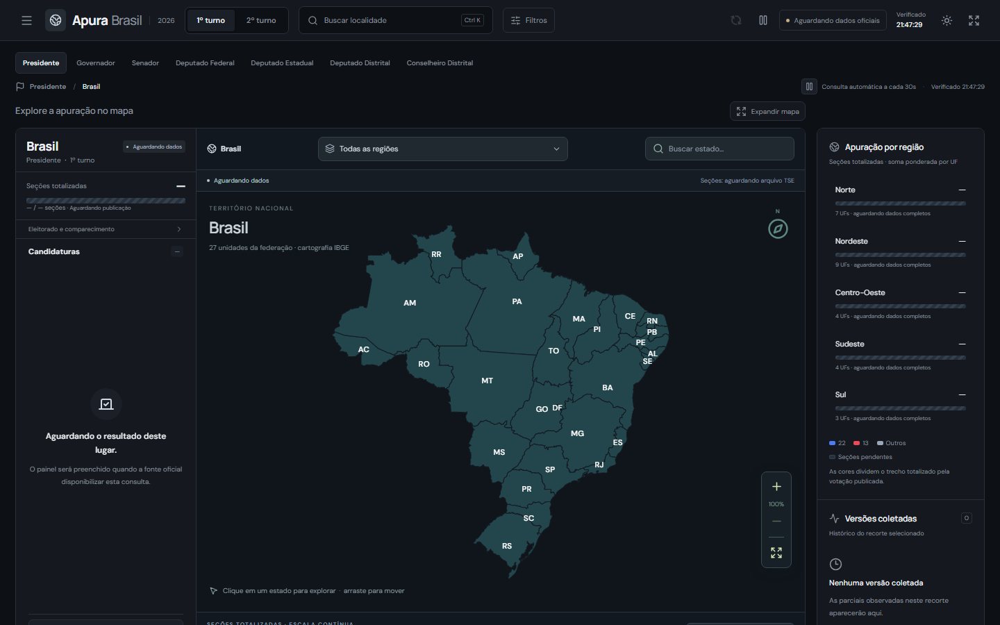
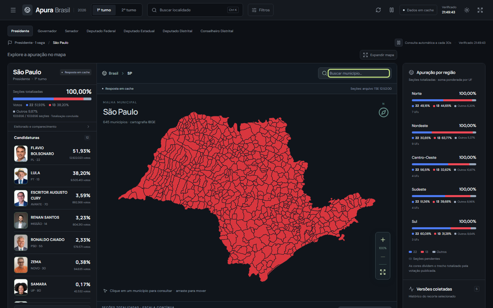

# Apura Brasil

Painel local para acompanhar a apuração das eleições pelos arquivos públicos do **TSE**: mapa do Brasil, das regiões, dos estados e dos municípios, candidaturas, comparação, histórico das versões publicadas e exportação. Feito para as eleições de 2026.



## Destaques

- **Mapa interativo próprio, em SVG**, sem biblioteca de mapas: Brasil → região → UF → município, com zoom no cursor, transições suaves e respeito ao "reduzir movimento" do sistema. A malha do IBGE é associada aos códigos do TSE só quando a correspondência é segura.
- **Só dado oficial.** Nenhuma amostra sintética: ausência continua ausência (não vira zero), e cada número mostra a fase, o arquivo e o horário de geração do TSE.
- **Somas regionais corretas.** O percentual de uma região soma os votos dos estados e divide pelos votos computados somados, em vez de fazer média de percentuais.
- **Atualização que respeita a fonte.** Cache em memória e em disco, requisições iguais agrupadas, revalidação condicional e pausa quando a aba fica oculta.
- **Segundo turno seguro.** O painel espera a configuração oficial do turno e nunca reaproveita dados do primeiro.
- Busca com **Ctrl + K**, favoritos, comparação de candidaturas, exportação CSV/JSON do recorte, modo telão e tema claro/escuro.



## English summary

A local dashboard for Brazilian election results, using public TSE election files and IBGE map data. React and TypeScript render the interface; a Node.js server manages caching, request coalescing, source attribution, and historical snapshots. It runs on your computer and is not an official TSE or IBGE product.

## Validação

A [CI](https://github.com/MakenRosa/apura-brasil/actions/workflows/ci.yml) executa verificação de tipos, testes com capturas locais e build. O comando adicional `npm run validate` inicia uma instância isolada com a rede externa bloqueada; ele não faz parte do workflow atual. Essa validação permite reproduzir os cenários guardados, mas não garante a disponibilidade futura dos serviços do TSE e do IBGE. Consulte [evidências e limitações](docs/VALIDACAO.md).

## Stack

React 19 · TypeScript · Vite · servidor HTTP em Node.js sem dependências · `node:test`

## Decisões técnicas

- **Servidor local como intermediário.** Um servidor em Node, só com módulos nativos ([server/](server)), baixa e guarda os arquivos do TSE e do IBGE. Assim o navegador não acessa as fontes diretamente, os limites de acesso são respeitados, e o cache e o histórico sobrevivem ao fechar o painel. Ele escuta só em `127.0.0.1`.
- **Projeção e câmera do mapa escritas à mão** ([src/lib/map-projection.ts](src/lib/map-projection.ts), [src/lib/map-camera.ts](src/lib/map-camera.ts)), sem Leaflet nem D3.
- **Contrato único entre servidor e interface:** os tipos ficam em [shared/types.ts](shared/types.ts), e a API está descrita em [docs/CONTRACT.md](docs/CONTRACT.md).
- **Testes com capturas reais.** 163 testes usam arquivos oficiais do TSE e do IBGE guardados em [tests/fixtures](tests/fixtures), sem rede, e `npm run validate` sobe o painel com a rede externa bloqueada.

## Rodar

Precisa do [Node.js](https://nodejs.org) 22.12 ou mais novo.

```bash
npm ci
npm run build
npm start
```

Abra http://127.0.0.1:4178. No Windows, `iniciar.cmd` abre o painel com o servidor em segundo plano e `encerrar.cmd` encerra.

| Comando | O que faz |
| --- | --- |
| `npm run dev` | Desenvolvimento com recarga |
| `npm test` | Testes (sem rede) |
| `npm run typecheck` | Verificação de tipos |
| `npm run validate` | Sobe o painel numa porta temporária, com a rede externa bloqueada |

O cache e o histórico ficam em `data/`. A variável `APURA_DATA_DIR` troca a pasta e `PORT` troca a porta.

## Fontes e créditos

- **Resultados, candidaturas e fotos:** Tribunal Superior Eleitoral ([dados abertos](https://dadosabertos.tse.jus.br/)). As fotos são publicadas sob Creative Commons Atribuição: **Fotos: TSE**.
- **Cartografia:** malhas territoriais do IBGE, com a procedência registrada em [public/map-source.json](public/map-source.json).
- O Apura Brasil não é um produto do TSE nem do IBGE.

Mais detalhes:
- [Como o painel funciona](docs/FUNCIONAMENTO.md)
- [Fontes e metodologia](docs/FONTES.md)
- [Cache da aplicação](docs/CACHE.md)
- [Evidências, testes e limitações](docs/VALIDACAO.md)
- [Contrato da API local](docs/CONTRACT.md)

## Licença

O código está sob a [licença MIT](LICENSE). Os dados exibidos pertencem às suas fontes.
